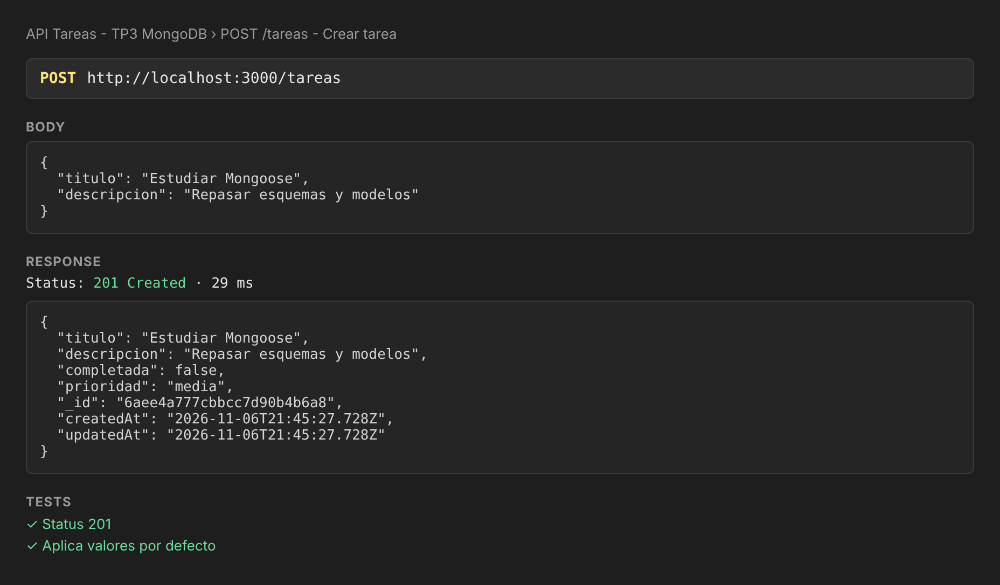
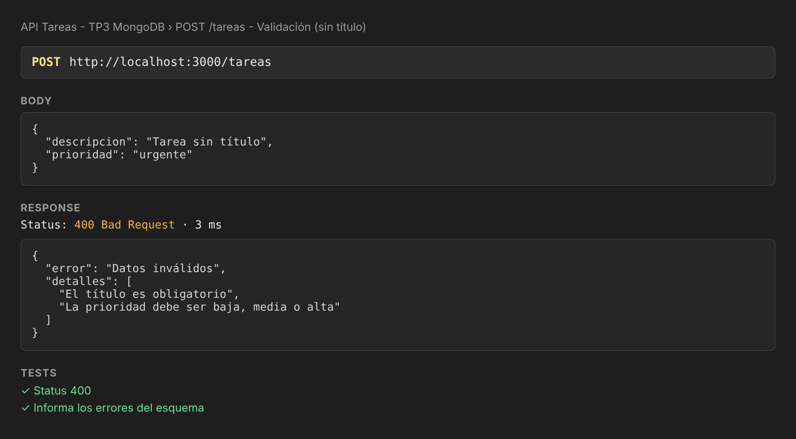
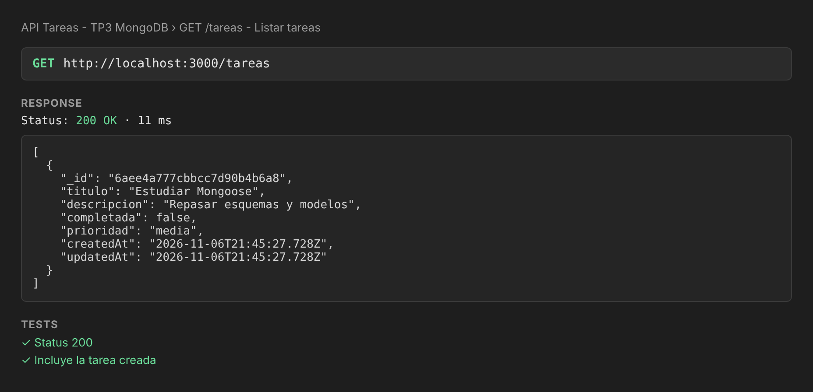
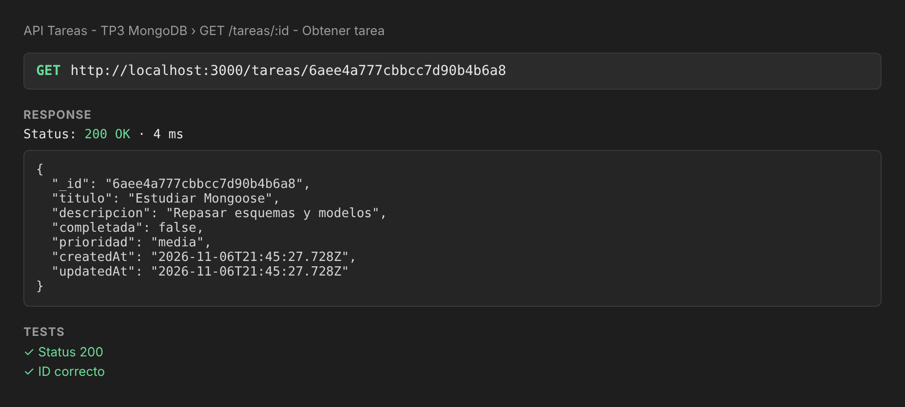
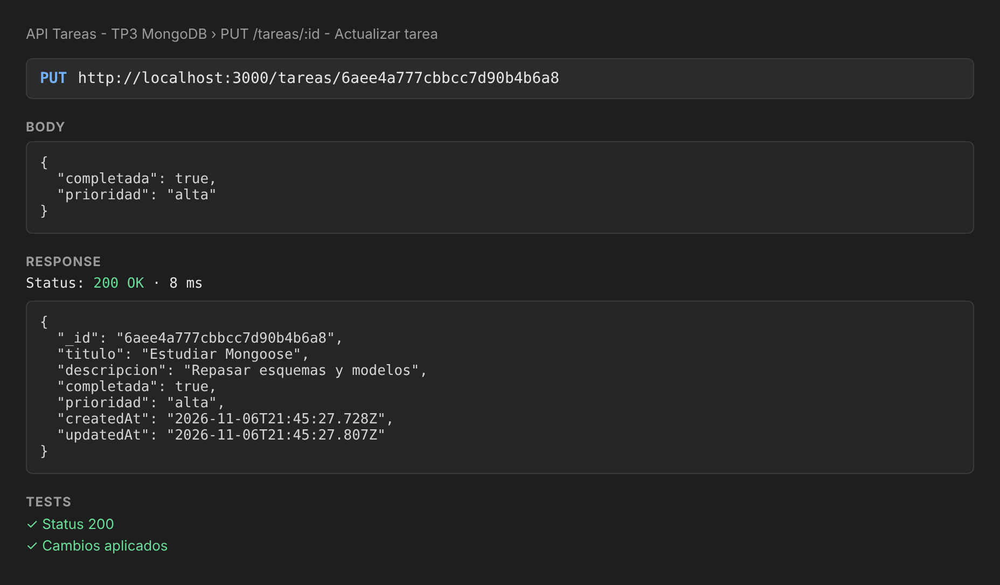
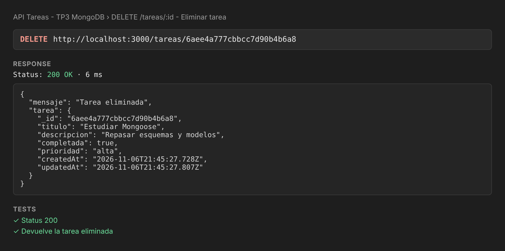
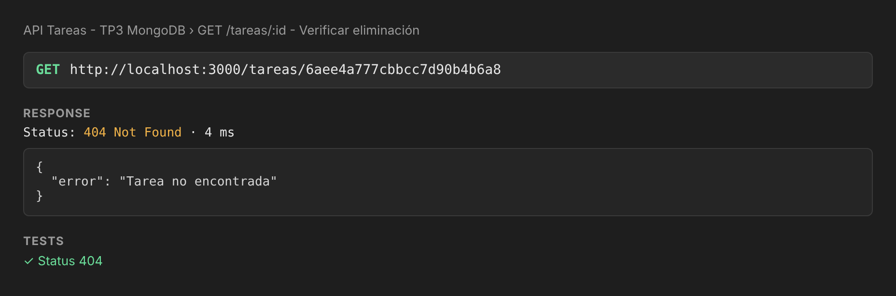
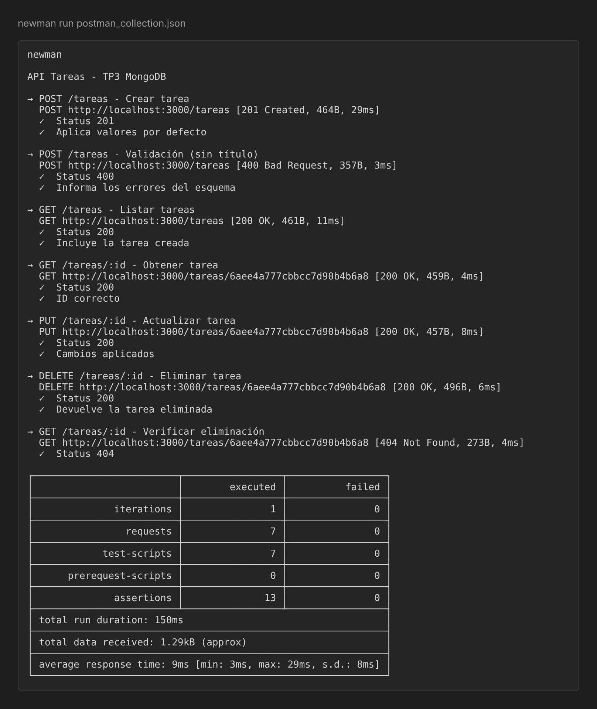

# API REST de Tareas con Express y MongoDB

API REST hecha con Express que se conecta a MongoDB con Mongoose y expone un CRUD de tareas. Los datos se validan con las reglas definidas en el esquema.

## Requisitos

- Node.js 18 o superior
- MongoDB corriendo en local, o una base en MongoDB Atlas

## Instalación y ejecución

```bash
git clone https://github.com/candelacorradin/node-tp3.git
cd node-tp3
npm install
cp .env.example .env
```

En `.env` se configura la cadena de conexión (este archivo está ignorado en GitHub):

```env
PORT=3000
MONGODB_URI=mongodb://127.0.0.1:27017/tp3
```

Para usar Atlas, reemplazá `MONGODB_URI` por la URL de tu cluster.

```bash
npm run dev      # con recarga automática
# o
node index.js
```

Si la conexión funciona, la consola muestra `✅ Conexión a MongoDB exitosa`. Si falla, muestra `❌ Error al conectar a MongoDB` junto con el motivo.

## Estructura

```
index.js                          # servidor Express y arranque
src/
  config/db.js                    # conexión a MongoDB
  models/Tarea.js                 # esquema y modelo
  controllers/tareas.controller.js
  routes/tareas.routes.js
postman_collection.json           # colección de pruebas
capturas/                         # capturas de las pruebas
```

## Esquema `Tarea`

| Campo         | Tipo    | Reglas                                            |
| ------------- | ------- | ------------------------------------------------- |
| `titulo`      | String  | **Obligatorio**, mínimo 3 caracteres              |
| `descripcion` | String  | Por defecto `""`                                  |
| `completada`  | Boolean | Por defecto `false`                               |
| `prioridad`   | String  | `baja`, `media` o `alta`. Por defecto `media`     |

También se guardan automáticamente `createdAt` y `updatedAt`.

## Rutas

| Método | Ruta          | Descripción              |
| ------ | ------------- | ------------------------ |
| POST   | `/tareas`     | Crea una tarea           |
| GET    | `/tareas`     | Lista todas las tareas   |
| GET    | `/tareas/:id` | Devuelve una tarea       |
| PUT    | `/tareas/:id` | Actualiza una tarea      |
| DELETE | `/tareas/:id` | Elimina una tarea        |

Si los datos no cumplen el esquema, la API responde `400` con el detalle de cada error. Si el ID no tiene un formato válido, también responde `400`, y si no existe la tarea responde `404`.

## Pruebas con Postman

Importá `postman_collection.json` en Postman. Las requests se ejecutan en orden: la primera crea una tarea y guarda su `_id`, que usan las siguientes. Al final se consulta la tarea eliminada para confirmar que ya no está en la base.

| Prueba | Captura |
| ------ | ------- |
| POST `/tareas` |  |
| POST `/tareas` con datos inválidos |  |
| GET `/tareas` |  |
| GET `/tareas/:id` |  |
| PUT `/tareas/:id` |  |
| DELETE `/tareas/:id` |  |
| GET `/tareas/:id` después de eliminar |  |
| Resumen de la ejecución |  |

## Autora

- **Estudiante:** Candela Corradin
- **Curso:** Diplomatura Full Stack — Centro de e-Learning UTN BA
- **Unidad:** Módulo 1 - Unidad 3 · Integrando Mongoose en mi API
